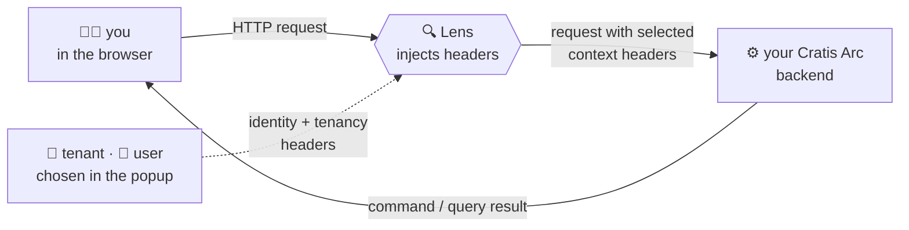

<div align="center">

# 🔍 Lens

Cratis Lens is a browser extension for inspecting commands, queries, users, and tenants while developing a Cratis Arc application.

**Choose a development context, inspect a command or query, and read its response in the browser.**

[](https://discord.gg/kt4AMpV8WV)
[](https://github.com/Cratis/Lens/actions/workflows/pull-requests.yml)
[](https://github.com/Cratis/Lens/actions/workflows/publish.yml)
[](LICENSE)

</div>

---

When you need to inspect a query under a different development context, Lens lets you choose the user and tenant in its popup instead of assembling request headers in a REST client. Start with Quick start below to build and load the extension, then open it from the application tab you want to inspect.

Check the host before switching users. The .NET Arc forwarded-header handler ignores Lens identity headers unless the host opts in through `Cratis:Arc:TrustForwardedIdentityHeaders`, which is off by default. Use an isolated development host for this: the headers are unsigned, and choosing a user in Lens is not a sign-in mechanism.

[Arc](https://github.com/Cratis/Arc) is the CQRS framework for ASP.NET Core. It works without
[Chronicle](https://github.com/Cratis/Chronicle), the MIT-licensed event-sourcing database. Lens inspects an Arc application; it is not an event-store browser.

## 🔍 Why "Lens"?

Three reasons, and they all line up:

- **The camera lens sets the point of view.** Choose a user and tenant to inspect how your development application responds to that context. The request coverage and host requirements below determine where that selection takes effect.
- **A lens is also what you inspect through.** Beyond the camera, a lens magnifies and focuses — it's an
  instrument for *seeing clearly*. Lens brings your commands and queries under the glass so you can test them
  and read back exactly what they return.
- **The Cratis storytelling family.** Cratis names its products after telling a story: **Chronicle** records
  what happened, **Arc** shapes the plot, **Screenplay** is the script, **Stage** performs it, **Studio**
  storyboards it, **Narrator** reads it back… **Lens** is the camera you watch the rehearsal through. It joins
  the cast.

## 🎥 What a session looks like

After loading Lens, open its toolbar popup from your application's tab. Lens looks for the page's Arc context and uses the detected base URL to load `/.cratis/commands` and `/.cratis/queries`. A detected page enables the explorers; it does not prove that the backend endpoints are reachable or accept the selected identity.

1. Open **Settings** to inspect the Users and Tenants lists. Use their refresh controls to request entries from the detected backend, or add entries for your development scenario.
2. Open **Context** and choose the active user and tenant. The selection is saved for this browser profile; changing it reloads matching application tabs.
3. Open **Queries**, choose a query from the namespace tree, supply any route parameters, and perform it. Read the response in the result panel before changing context and comparing the next result.

If Commands or Queries is disabled, return to the application tab and use the popup's Arc detection status control to retry. If detection succeeds but a catalog request fails, inspect that request in browser developer tools: discovery access and the selected context are separate concerns. For commands, check the payload form before executing; without a schema, Lens sends an empty payload object.

## 🧠 How it works — header injection at the boundary

Lens has two request paths. The popup adds selected context headers when it executes a command or performs a query. The background service worker also installs browser rules for matching application XHR/fetch requests, using the detected page host or backend host to scope them. With no usable host scope, it installs no rules:



- **Identity headers** — Lens sends the selected user's identity and claims as forwarded headers. The host's authentication and authorization configuration decides what to accept; the popup cannot grant permissions. See the
  [Cratis Arc authentication specification](https://www.cratis.io/arc/backend/core/authentication/#microsoft-identity-platform-azure).
- **Tenancy headers** — Lens sends the selected tenant identifier under `x-cratis-tenant-id` by default. Your application must resolve tenancy from the corresponding header; choosing a tenant does not establish access to it. See the
  [Cratis Arc tenancy resolvers specification](https://www.cratis.io/arc/backend/tenancy/resolvers/).

The browser rules select the XMLHttpRequest resource type. Inspect an observable-query transport's actual request before assuming that it carries the selected context. The popup's command and query catalog requests are separate fetches that do not add selected context headers. A working query request therefore does not establish that discovery or an observable-query transport uses the same context.

Changing the active user or tenant removes the Arc `.cratis-identity` cookie on the configured origins and reloads matching tabs. That cookie is legacy in current .NET Arc; its removal is not proof of a new authenticated session. The reload also clears the frontend's in-memory identity. For .NET Arc hosts that expose `/.cratis/me`, inspect that response in the application's network traffic after the reload to check the identity the host reports, rather than relying on the popup selection.

## ✨ Features at a glance

| Feature | Purpose |
| --- | --- |
| **🏢 Tenant Selector** | Select the tenant header value for matching requests |
| **👤 User Selector** | Select the identity and claims to send with requests |
| **🔌 Arc Development Sources** | Refresh user and tenant lists from the detected backend |
| **🧪 Command Explorer** | Execute commands; payload fields appear when Lens finds a schema |
| **🧪 Query Explorer** | Run queries and inspect the payloads that come back |
| **📈 Query Diagnostics** | Inspect snapshots when the page exposes observable-query diagnostics |
| **🔧 Context View** | See the current tenant, user, and identity context |

## 🚀 Quick start

Have Node.js, Yarn and a running local Arc application ready. Build the extension first; the build produces the directory Chrome loads, but does not install it:

```bash
cd Source
yarn install
yarn build                 # bundles the unpacked extension into Source/dist/
```

Then, in Chrome:

1. Open `chrome://extensions/`
2. Enable **Developer mode**
3. Click **Load unpacked** and select the `Source/dist` folder

Chrome should now list **Cratis Lens**. Open your local Arc application and then the Lens popup from that tab so detection can supply the backend address. Settings manages the user and tenant lists; Context chooses which entries to use. Follow the session above to inspect a query and its response.

For the build-and-load walkthrough and its prerequisites, continue with Local Development under [`Documentation/GettingStarted`](Documentation/GettingStarted/index.md). That index also links the user/tenant guide; publishing is a separate task, not a step required to use Lens locally.

If you are changing Lens itself, use the watcher and reload the extension after each rebuild:

```bash
cd Source
yarn dev                   # Vite rebuilds on change; reload the extension after each build
yarn test                  # run the specs
yarn ci                    # typecheck, specs and build — the same gate CI runs
```

## 🗺️ What's in this repo

```plaintext
Source/
├── manifest.json           # extension manifest (MV3)
├── main.tsx / LensPopup.tsx # popup UI entry point
├── background/             # service worker that injects headers
├── commands/               # command explorer
├── queries/                # query explorer
├── observable-query-diagnostics/  # live observable-query health
├── settings/               # configuration, tenant/user management
├── context/                # identity and tenancy context
├── shared/                 # shared utilities and types
├── testing/                # spec helpers (chrome API stub, builders)
└── arc/                    # Cratis Arc integration
```

Specs sit next to what they specify, in `for_<Subject>/when_<context>.ts` folders — the same BDD shape as
the rest of Cratis.

## ✅ Quality gates

```bash
cd Source
yarn typecheck   # zero TypeScript errors
yarn test        # all specs green
yarn build       # the extension builds clean
yarn ci          # all three, as CI runs them
```

## 🔗 Links

- [Cratis Arc documentation](https://www.cratis.io/arc/)
- [Authentication & identity](https://www.cratis.io/arc/backend/core/authentication/#microsoft-identity-platform-azure)
- [Tenancy & resolvers](https://www.cratis.io/arc/backend/tenancy/resolvers/)
- [Cratis Chronicle](https://www.cratis.io/chronicle/) · [repository](https://github.com/Cratis/Chronicle)
- [Narrator](https://github.com/Cratis/Narrator) — browse Chronicle event stores from VS Code
- [Synopsis](https://github.com/Cratis/Synopsis) — turn your specs into living documentation
- [Privacy policy](PRIVACY_POLICY.md) — what Lens does and doesn't collect

## 🎬 The Cratis ecosystem

This project is part of [Cratis](https://www.cratis.io) — tools for building event-sourced
and CQRS applications.

- **[Chronicle](https://github.com/Cratis/Chronicle)** — event-sourcing database and runtime. Orleans-based kernel, pluggable storage (MongoDB default; PostgreSQL, SQL Server, SQLite, in-memory), language-agnostic gRPC contracts. [Docs](https://www.cratis.io/chronicle/)
- **Chronicle clients** — first-class [.NET SDK](https://github.com/Cratis/Chronicle), plus [TypeScript](https://github.com/Cratis/Chronicle.TypeScript), [Kotlin/Java](https://github.com/Cratis/Chronicle.Kotlin), and [Elixir](https://github.com/Cratis/Chronicle.Elixir); [Python](https://github.com/Cratis/Chronicle.Python) coming soon. AI agents connect through the [Chronicle MCP server](https://github.com/Cratis/Chronicle.Mcp).
- **[Arc](https://github.com/Cratis/Arc)** — opinionated CQRS framework for ASP.NET Core with commands, queries, validation, authorization, and TypeScript proxy generation. Works without event sourcing. [Docs](https://www.cratis.io/arc/)
- **[Components](https://github.com/Cratis/Components)** — React components aligned with Arc patterns. [Docs](https://www.cratis.io/components/)
- **[CLI](https://github.com/Cratis/cli) + Workbench** — inspect and diagnose Chronicle from the terminal or the browser. [Docs](https://www.cratis.io/cli/)
- **Model-first layer** — [Studio](https://github.com/Cratis/Studio), [Screenplay](https://github.com/Cratis/Screenplay), [Stage](https://github.com/Cratis/Stage), [Scene](https://github.com/Cratis/Scene), [Prologue](https://github.com/Cratis/Prologue)
- **Supporting** — [Fundamentals](https://github.com/Cratis/Fundamentals), [Specifications](https://github.com/Cratis/Specifications), [Synopsis](https://github.com/Cratis/Synopsis), Lens (this repository), [Narrator](https://github.com/Cratis/Narrator), and free [AI tooling](https://github.com/Cratis/AI); [Ensemble](https://github.com/Cratis/Ensemble) coming soon
- **[Samples](https://github.com/Cratis/Samples)** — runnable event sourcing and CQRS samples for the whole stack

Lens is MIT licensed and free to use.

---

<div align="center">

*Part of the [Cratis](https://www.cratis.io) platform · Licensed under the [MIT license](LICENSE)*

</div>
